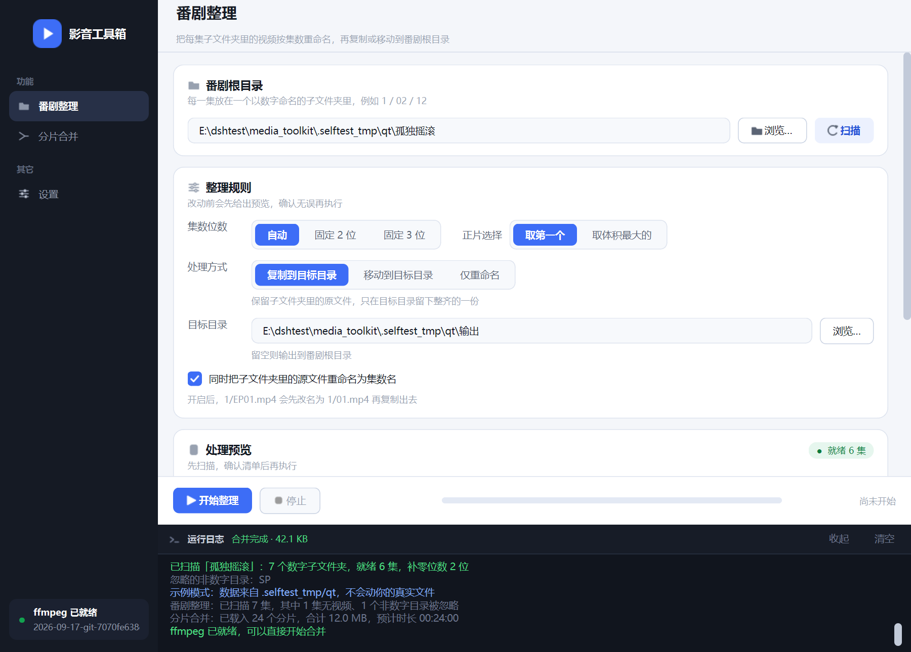
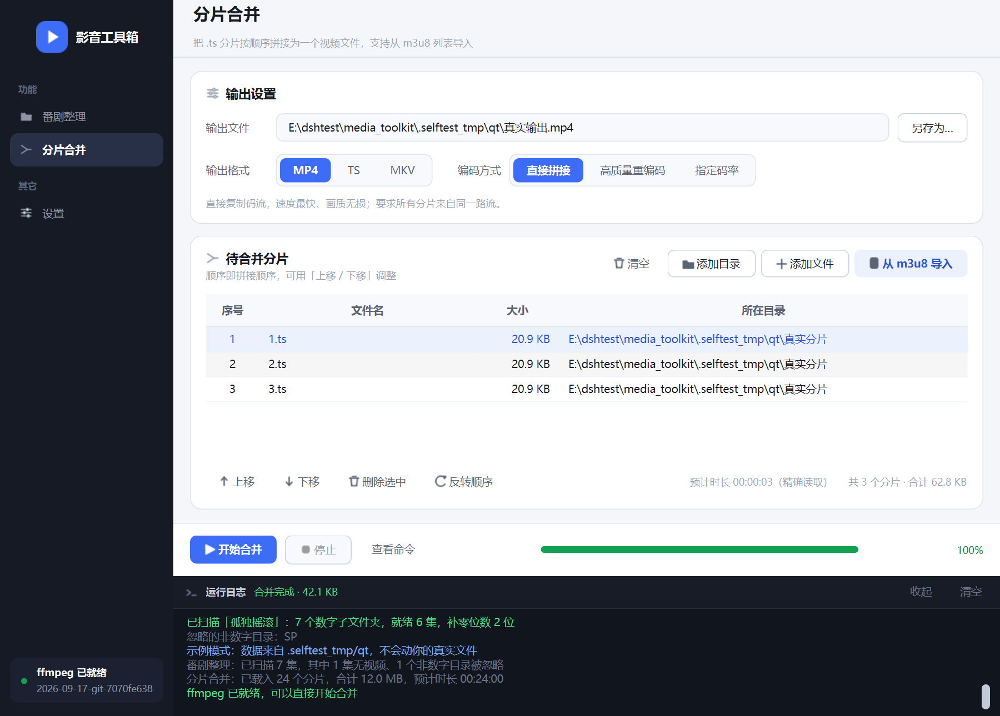
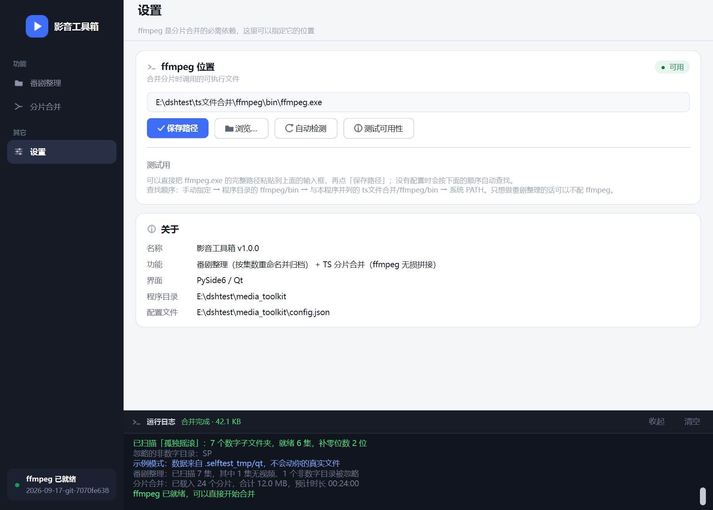

# 影音工具箱 · MediaToolkit

简体中文 | [English](README.en.md)

一个界面清爽的 Windows 桌面工具箱，合并了先前的两个项目
[A_program_for_ts_files_concatenation](https://github.com/Dreaky314/A_program_for_ts_files_concatenation.git)
[video_rename_and_copy](https://github.com/Dreaky314/video_rename_and_copy.git)
后续根据需求会增加新功能

- **番剧整理** —— 把按集数分文件夹的番剧视频批量重命名并归档
- **分片合并** —— 把流媒体缓存的 `.ts` 分片无损拼成一个视频文件

界面用 **PySide6 / Qt** 实现，逻辑层与界面完全解耦，可在脚本里直接调用。





---

## 目录

- [功能](#功能)
  - [番剧整理](#番剧整理)
  - [分片合并](#分片合并)
  - [设置](#设置)
- [快速开始](#快速开始)
- [技术栈](#技术栈)
- [目录结构](#目录结构)
- [开发与测试](#开发与测试)
- [打包成 exe](#打包成-exe)
- [关于 SmartScreen](#关于-smartscreen)
- [一些踩过的坑](#一些踩过的坑)
- [License](#license)

---

## 功能

### 番剧整理

把每一集放在一个以数字命名的子文件夹里（`1` / `02` / `12` …），程序会：

- 扫描根目录下所有**以数字命名**的子文件夹
- 从每集子文件夹里挑一个视频作为正片（默认取文件名排第一的，也可按体积最大挑）
- 重命名为补零后的集数名（`01.mp4`），位数按最大集数自动推导，也可固定 2 / 3 位
- 三种处理方式：
  - **复制**到目标目录（保留原文件）
  - **移动**到目标目录（节省磁盘）
  - **仅在原文件夹内重命名**（不产生新文件）
- 可选「同时把子文件夹里的源文件重命名为集数名」
- 执行前在表格里给出完整预览：集数、源文件、新文件名、大小、状态
- 自动识别并标注：**没有视频的文件夹**、**目标已存在**、**同批次命名冲突**（如 `1` 与 `01` 并存）
- 非数字目录（`SP`、`封面` 等）会被忽略并在日志里列出
- 双击某一行可在资源管理器里打开那一集的文件夹

### 分片合并

- 三种导入方式：**添加文件**、**添加目录**（目录下没有分片时自动递归找一层）、**从 m3u8 导入**
- 列表可上移 / 下移 / 删除 / 反转，顺序即拼接顺序
- 输出格式 **MP4 / TS / MKV**，切换格式自动改输出文件扩展名
- 三种编码方式：
  | 方式 | 参数 | 适用 |
  | --- | --- | --- |
  | 直接拼接 | `-c copy` | 最快、无损，要求分片来自同一路流 |
  | 高质量重编码 | `libx264 -crf 18` | 兼容性最好，耗时较长 |
  | 指定码率 | `libx264 -b:v 8M` | 需要控制文件体积 |
- 实时进度：解析 ffmpeg 统计输出，显示**百分比 / 已处理时长 / 倍速**
- 输出 MP4 时自动附加 `aac_adtstoasc` 与 `+faststart`
- 「查看命令」可看到实际执行的 ffmpeg 命令行
- m3u8 导入时会提示**加密标签**、缺少 `#EXT-X-ENDLIST`、**分片缺失**等情况

### 设置

- ffmpeg 路径**可直接手填 / 粘贴**，点「保存路径」写入 `config.json`
- 也支持浏览选择、一键自动检测、测试可用性
- 查找顺序：手动指定 → 程序目录 `ffmpeg/bin` → 系统 PATH
- 只做番剧整理时**不需要** ffmpeg



---

## 快速开始

### 环境要求

| 项目 | 要求 |
| --- | --- |
| 系统 | Windows 10 / 11（64 位） |
| Python | 3.9+（开发环境为 3.14.7） |
| ffmpeg | 仅在「分片合并」时需要 |
（运行已编译的.exe时不需要）

### 安装与运行

**双击`影音工具箱.exe`即可**

**备选双击 `启动.bat` 启动。**

首次需要先创建虚拟环境：

```bat
python -m venv --without-pip --system-site-packages .venv
.venv\Scripts\python.exe -m pip install PySide6
```

> `--without-pip --system-site-packages` 用于绕开 `ensurepip` 在受限环境下的写入限制，
> 并复用全局 pip。装好后 `.venv` 里只有 PySide6，**不会影响你的全局 Python 环境**。

之后手动启动：

```bat
.venv\Scripts\pythonw.exe app_qt.py
```

## 目录结构

```
media_toolkit/
├─ app_qt.py                程序入口
├─ 启动.bat                 双击启动（不经过 exe）
├─ build_exe.py             打包成 exe
├─ core/                    逻辑层：与界面完全解耦，可单独调用
│  ├─ config.py             程序目录、config.json、资源路径解析
│  ├─ ffmpeg.py             ffmpeg/ffprobe 定位、校验、时长探测
│  ├─ m3u8.py               m3u8 解析
│  ├─ merge.py              concat 列表、命令构建、带进度的执行器
│  ├─ rename.py             番剧扫描、命名规划、复制/移动执行器
│  └─ osutil.py             打开目录 / 定位文件（多级回退）
├─ qtui/                    Qt 界面层
│  ├─ theme.py              调色板 + 全局 QSS + 字体
│  ├─ widgets.py            卡片、徽标、分段控件、统计块、矢量图标、日志台
│  ├─ main_window.py        主窗口：侧边导航 + 页面栈 + 共用日志面板
│  ├─ page_rename.py        番剧整理页
│  ├─ page_merge.py         分片合并页
│  └─ page_settings.py      设置页
├─ assets/                  图标资源（app.ico / check.svg）
├─ docs/                    界面截图
└─ tools/                   开发用脚本
   ├─ selftest.py           逻辑层单测（57 项）
   ├─ e2e_merge_test.py     用真实 ffmpeg 跑端到端合并
   ├─ qt_smoke.py           Qt 界面冒烟 + 截图（56 项）
   ├─ qt_perf.py            Qt 缩放性能实测
   └─ make_icon.py          用 Qt 生成多尺寸方形图标
```

---

## 开发与测试

```bat
:: 逻辑层
python tools\selftest.py           :: 单元测试（57 项）
python tools\e2e_merge_test.py     :: 真实 ffmpeg 端到端

:: Qt 界面
.venv\Scripts\python.exe tools\qt_smoke.py            :: 冒烟测试（56 项）
.venv\Scripts\python.exe tools\qt_smoke.py --shots    :: 同时导出截图
.venv\Scripts\python.exe tools\qt_perf.py             :: 缩放性能对比
```

- 全部测试使用标准库 `unittest` 风格的手写断言，**不需要 pytest**。
- 测试数据写入项目内的 `.selftest_tmp/`，**不会碰你的真实媒体文件**。

---

## 打包成 exe

```bat
.venv\Scripts\python.exe build_exe.py
```

产物位于 `dist/影音工具箱/`，约 **97 MB**（含 Qt 运行库，已排除 WebEngine 等无用模块）。

ffmpeg 体积较大（约 100 MB/个），默认**不**打包，程序会在系统 PATH 中查找。
需要一起打包时：

```bat
.venv\Scripts\python.exe build_exe.py --with-ffmpeg "D:\ffmpeg\bin\ffmpeg.exe"
```

图标资源 `assets/app.ico` 包含 **16/24/32/48/64/128/256 七个尺寸**，可用
`tools/make_icon.py` 重新生成。

---

## 关于 SmartScreen

PyInstaller 打出的 exe **没有代码签名**，第一次运行会弹
「Microsoft Defender SmartScreen 阻止了无法识别的应用」。三个选择：

1. 弹窗里点 **「更多信息」→「仍要运行」**（每个新编译的 exe 只需点一次）
2. **直接用 `启动.bat`**（推荐），运行源码而非可执行文件，永不触发该提示
3. 购买**代码签名证书**并为 exe 签名（唯一能从根上消除提示的方式）

若使用 Windows 11 且开启了「智能应用控制」，它比 SmartScreen 更严格，
需在「Windows 安全中心 → 应用和浏览器控制」中调整，或同样改用 `启动.bat`。

---

## 一些踩过的坑

### Qt

- **QSS 中 `url()` 必须使用绝对路径和正斜杠**，写成 `:/qt/...` 这类资源路径会报 `Cannot open file`。
  `theme.asset_path()` 会计算绝对路径，文件不存在时整条规则不输出。
- **`QWidget { background: ... }` 会污染所有子控件**（包括 QLabel）。背景只加在带 `objectName` 的容器上。
- **自定义控件改值时要同步内部状态**：`Segmented.set()` 只改视觉，业务侧改值时必须同时更新。
- **绘制描边圆圈前要 `setBrush(Qt.NoBrush)`**，否则会被填充成实心。
- **跨线程回调必须用信号**：core 的回调运行在工作线程，统一通过 `QObject` 的 Signal 投递到 UI 线程。
- **`QFontDatabase` 需要先有 `QApplication`**。
- **打包后资源路径会变**：PyInstaller `--add-data` 在 onedir 模式下落进 `_internal/`。
  统一走 `core/config.resource_path()`，依次查 `sys._MEIPASS` → 程序目录 → `程序目录/_internal`。
- **窗口图标要显式设在窗口上**：只调 `QApplication.setWindowIcon()` 时，已创建窗口的 `windowIcon()` 仍为空。

### 通用

- **绝不能给 `explorer.exe` 传 `CREATE_NO_WINDOW`**：会导致 DLL 初始化失败并弹出
  「explorer.exe - Application Error (0xc0000142)」。该标志只适用于 ffmpeg 这类控制台程序。
  `core/osutil.py` 只重定向子进程 stdio，不传任何 creationflags。
- **`.bat` 文件不要用 UTF-8 编码保存中文**：cmd.exe 按系统 ANSI 码页（简体中文为 GBK）解析 .bat，
  UTF-8 中文会解码成乱码并使整行错位。`启动.bat` 因此**全文只用 ASCII**。
- **ffprobe 读不出 TS 的总时长**：`-f concat` 列表对 MPEG-TS 恒返回 `duration=N/A`。
  改为：m3u8 用 `#EXTINF` 累加；小列表并行逐个探测求和；大列表抽样估算。

---

## License

MIT License
